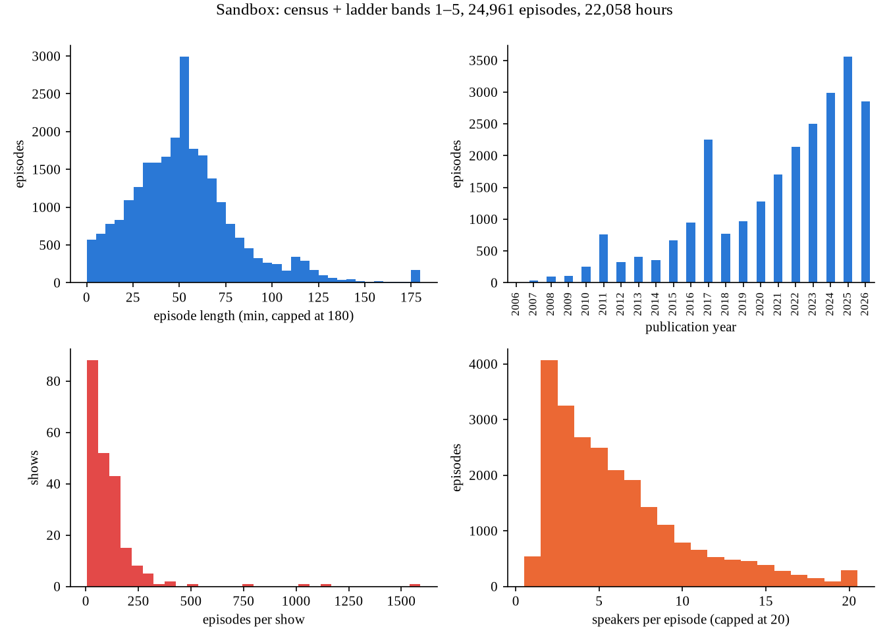
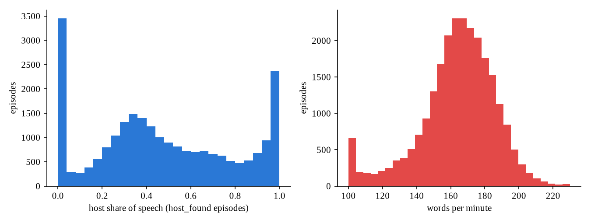

# Sandbox: the k = 5 ladder slice of the corpus

A self-contained, exploration-sized slice of the political podcast corpus, built by `step2_sample/build_sandbox.py`, last rebuilt 27 November 2026. It is the **k = 5 design**: every pre-2018 episode (the census) plus ladder bands 1–5, i.e. the first five random draws per show-quarter from 2018 on, for all 219 frame shows. Because draw order within a show-quarter is random, this slice is a stratified random sample of the full corpus and any distribution computed on it is an unbiased estimate for the frame, with the same caveat as the full corpus: shows are capped per quarter, so compare rates, not totals.

## What is in it

| | sandbox | full corpus |
|---|---|---|
| shows | 219 | 219 |
| episodes | 24,961 (6,207 census + 18,754 ladder) | 85,127 |
| audio hours | 22,058 | 75,029 |
| words | 216.2 million | 749.3 million |
| episodes with a speaker layer | 23,896 (95.7%) | 82,129 (96.5%) |
| size on disk | 5.4 GB | ~750 GB with audio |

```
episodes.csv              one row per episode: show_id, episode_id, title, pub_date, stratum, band,
                          quarter, duration (s), n_segments, n_words, model, transcript_source,
                          n_speakers, n_hosts, host_share, host_status, aligned
shows.csv                 the 204 shows: chart rank, publisher, lean, fixed host, political density,
                          corpus and sandbox counts
transcripts/<show_id>/<episode_id>.json   segments [{start, end, text}] plus episode metadata;
                                          the audio-aligned re-transcription where one exists
                                          (transcript_source = "archive", 13,749 episodes), otherwise
                                          the original, which already matched the audio (11,212)
transcripts/<show_id>/<episode_id>.txt    plain text, one segment per line
diarization/<show_id>/<episode_id>.json   turns, exclusive_turns, speakers (duration, share, 256-d
                                          centroid), segments with speaker + purity, provenance
speakers/episode_hosts.csv, episode_speakers.csv, show_hosts.csv   host identification tables
measures/mfte_episode_rates.csv           address rates (vimp, pp2 per 10k words) where scored
measures/mfte_imperative_episode_counts.csv   command types per episode
measures/show_level_outcomes.csv          the 194-show analysis table (all show-level measures)
figures/distributions.png, speech.png     the plots below
stats.json                                the numbers in this file, machine-readable
```

Join keys: `show_id` (Apple collection id) and `episode_id` (16-hex hash). Field meanings are in section 10 of `results/corpus_overview.md`.

## Distributions

**Episode length.** Median 50.9 minutes, 10th–90th percentile 18.3–87.6. The spike at 50–55 minutes is the hour-with-ads format of daily and weekly shows; the tail to three hours is the long-form interview shows.

**Publication year.** Census years are complete and small; from 2018 the slice grows with the medium: 769 episodes in 2018, 1,704 in 2021, 2,991 in 2024, 3,556 in 2025 and 2,848 in the first half of 2026. (Hours track episodes closely: 672, 1,490, 2,618, 3,252, 2,603.)

**Episodes per show.** Median 84, from 6 to 1,591. The right tail is the census: shows with large pre-2018 catalogues contribute every one of those episodes. Post-2018 contributions are at most five per quarter, so a show active throughout 2018–2026 contributes about 170 ladder episodes.

**Speakers per episode.** Median 5 voices (after pyannote's clustering), with a long tail from panel shows and clip-heavy news programmes; the count of voices with at least 5% of the speech is 3 in the median episode.

**Host status.** 21,032 episodes (88.0%) have a recurring host voice, 439 (1.8%) are guest-hosted or specials in fixed-host shows, 2,425 (10.1%) belong to the 29 rotating-presenter feeds. Where a host is found, the host's share of speech has median 0.51.

**Speech rate.** Median 167 words per minute.

**Alignment.** Every sandbox episode's transcript timestamps match the shipped audio: 13,749 were re-transcribed from the archived audio, 11,212 already matched. The `aligned` column in episodes.csv is therefore 1 throughout.





## Using it

```python
import pandas as pd, json
ep = pd.read_csv("sandbox/episodes.csv", dtype={"show_id": str, "episode_id": str}, parse_dates=["pub_date"])
rec = json.load(open(f"sandbox/diarization/{ep.show_id[0]}/{ep.episode_id[0]}.json"))
host_lines = [s["text"] for s in rec["segments"] if s["purity"] >= 0.8 and
              s["speaker"] in {k for k, v in rec["speakers"].items()}]   # join speakers/episode_speakers.csv for is_host
```

Rebuild with a different depth: `.venv/bin/python step2_sample/build_sandbox.py --bands 1` gives one episode per show-quarter (3,820 ladder episodes plus the census); `--bands 15` gives the paper's frozen-design depth.
